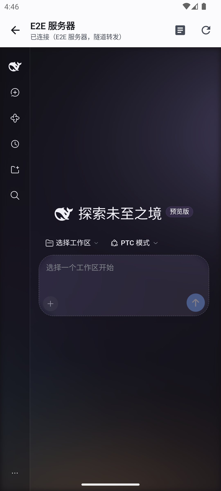
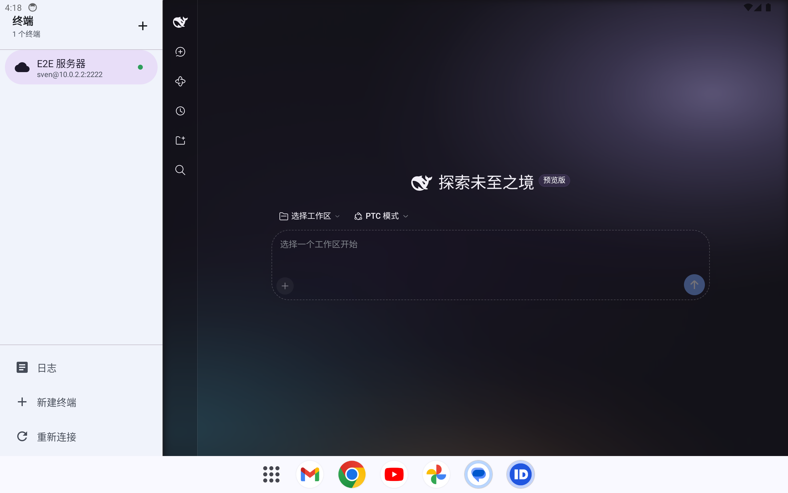
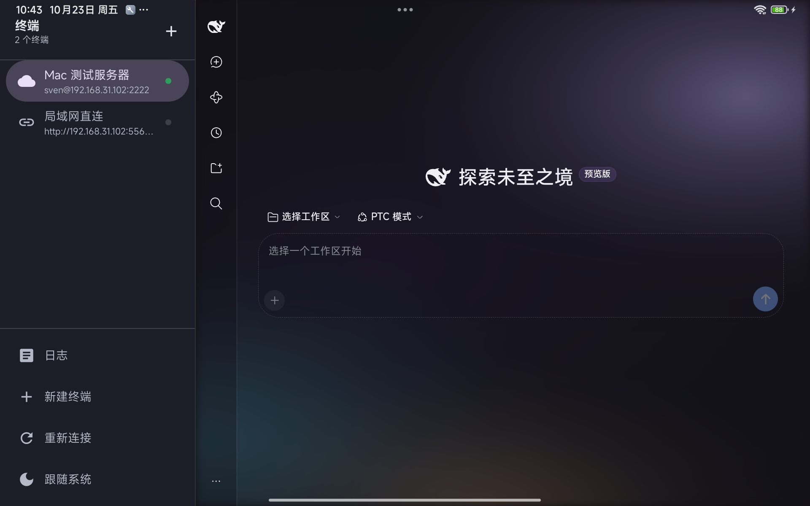
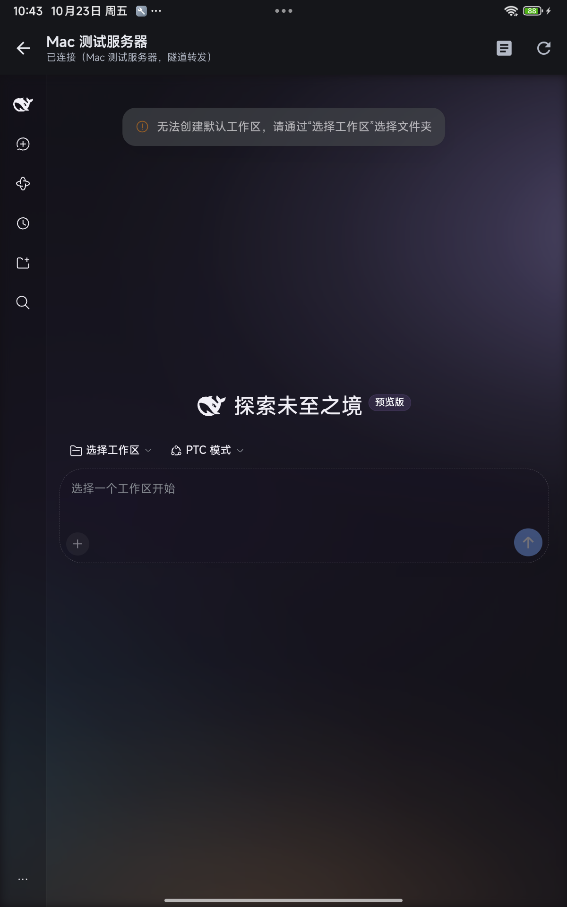
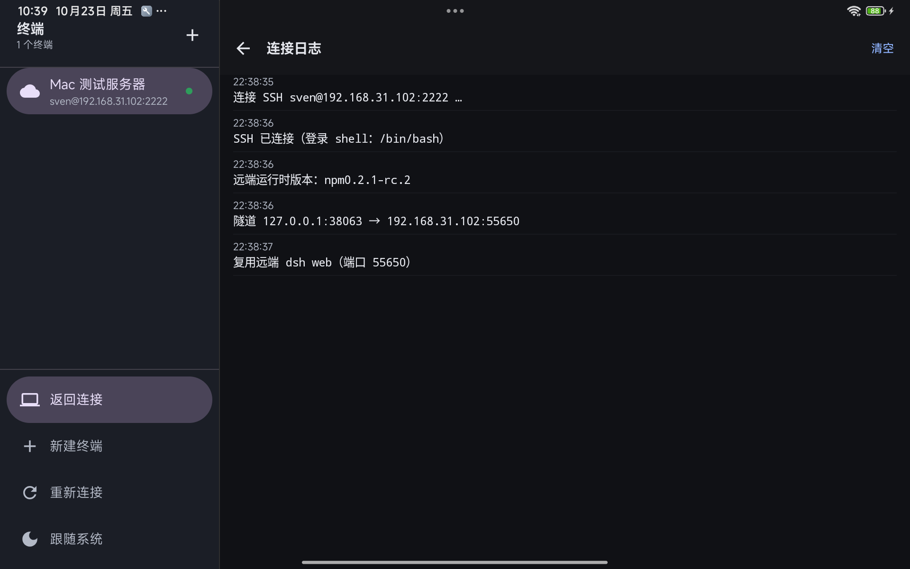
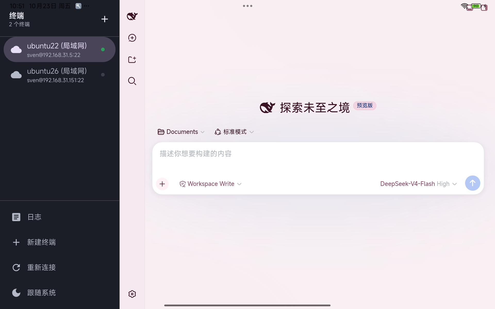
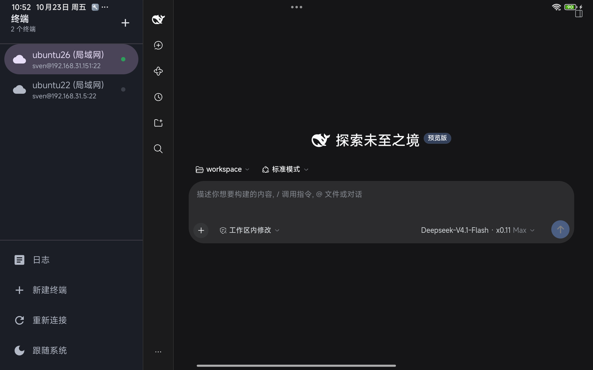

# DeepSeek Harness for Android

A native Android client for DeepSeek Harness: Kotlin + Compose + WebView, with an
SSH transport and port forwarding so a phone or tablet can drive a harness
running on any Linux box.

This is **not** the desktop Electron shell ported to a phone. It speaks the same
*remote protocol* (the same `dsh web` service, the same state file, the same
launch token) so both clients can share one resident service on the same
machine — but every UI decision here is made for touch, portrait, and a screen
that may be 400dp or 1280dp wide.

## Why a native client

The desktop shell's job — install a runtime, keep a service alive, tunnel to it —
maps onto Android cleanly except for three things, and those three are what this
app is built around:

| Desktop shell | Android reality | What this client does |
|---|---|---|
| `ssh -N -L` child process | No child processes; no `ssh` binary | JSch session with `setPortForwardingL` |
| Electron `WebContentsView` | System WebView, version varies by device | Document-start compatibility shim |
| App lives until quit | Process can be frozen or killed | Foreground service holds the connection |

## Features

- **SSH remote mode** — connect to `[user@]host[:port]` with an imported private
  key. The client reuses a healthy remote `dsh web` when its version matches the
  active runtime, and otherwise clears stale hosts, launches a fresh service, and
  records it in `~/.dsh/desktop-web.state.json` exactly like the desktop shell.
- **Direct URL mode** — no SSH, no managed service. Paste a URL that already
  reaches a harness (reverse proxy, LAN address) and the client just loads it.
- **Adaptive layout** — see below.
- **Background survival** — a data-sync foreground service keeps the tunnel alive
  while the app is backgrounded, and the ready state is probed every 4s so an
  in-place harness restart is followed to the new port automatically.
- **In-app log** — every connection step, the remote login shell it resolved, the
  tunnel ports, and the full remote error output. On a phone there is no terminal
  to inspect, so this is the only way to diagnose a refused SSH handshake.

## Layout: phone portrait vs tablet landscape

```
phone portrait                      tablet landscape
┌──────────────────┐                ┌──────────┬────────────────────────┐
│ terminals list   │                │          │                        │
│  ┌────────────┐  │                │  rail    │      harness           │
│  │ E2E 服务器  │  │                │ 264dp    │      (full height)     │
│  └────────────┘  │  tap          │          │                        │
│        ↓         │  ───         │ ┌──────┐ │                        │
│ ┌──────────────┐ │               │ │ E2E  │ │                        │
│ │   harness    │ │               │ └──────┘ │                        │
│ │  (fullscreen)│ │               │          │                        │
│ └──────────────┘ │               │ 日志      │                        │
└──────────────────┘                └──────────┴────────────────────────┘
```

The decision is made from the **window** size (`FormFactor`), not the device
screen: on Android 12+ a tablet in split-screen has a phone-width window, and
forcing the two-pane layout there would squeeze a 264dp rail into 400dp.

Rotating a tablet therefore switches layouts live, without dropping the page:
the harness WebView is recreated only when the URL authority changes, so a
rotation keeps the conversation and its scroll position.

The phone layout is a route stack, not a drawer: tapping a terminal replaces the
list with the harness full-screen, because on a phone every dp belongs to the
conversation, and the back arrow returns to the list. The tablet layout keeps
both visible at all times so switching terminals costs no navigation.

## Connection sequence (SSH)

This mirrors `src/connection.js` in the desktop shell step for step; the remote
side is the same service, and each step exists for a reason discovered there.

1. **SSH connect** (JSch, public key). `StrictHostKeyChecking=accept-new`,
   server-alive every 30s.
2. **Resolve the login shell** — `getent passwd` column 7, then `$SHELL`, then a
   fixed list. Commands run as `<shell> -l -c '<cmd>'`. Skipping `-l` is how the
   harness silently exits 0 with no output when node lives on a profile PATH.
3. **Read `~/.dsh/desktop-web.state.json`** → `{pid, port, version, url}`.
4. **Adopt** if `state.version` equals the active runtime's `manifest.json#current`
   and the port answers `curl -sL` with `__DSH_BOOT__` or the 401 auth notice.
   Then open the forward and hand the WebView `rehostUrl(state.url, localPort)` —
   the token is port-agnostic, the cookie it mints is bound to the authority.
5. **Launch** otherwise: kill recorded pid → sweep every `dsh web` over *this*
   dsh home (`usesHome`-confined) → `setsid sh -c '… exec node bin.js web --port 0'`
   → poll the port file 150×0.2s → write the state file (trailing newline is
   load-bearing: the remote command is parsed per line between sentinels).
6. **Forward + rehost**, then probe through the tunnel.
7. **Watchdog** — every 4s while ready; two consecutive failures reconnect.

Every remote command is wrapped in random sentinel markers, because some ssh
gateways print an `authz success` banner before the command runs, and every
parse would otherwise have to skip unknown lines.

## WebView compatibility

The harness client bundle calls `Promise.withResolvers` (Chromium 119) and
`AbortSignal.any` (Chromium 116) **at module scope**. On an older WebView the
bundle aborts before rendering anything: a blank page with no visible reason.

Rather than telling users of Android 8–13 devices — whose vendors never shipped
a newer WebView — to update something they cannot update, `WebViewCompatScript`
injects a document-start shim that defines only the *missing* functions:

| API | Introduced | Why the harness needs it |
|---|---|---|
| `Promise.withResolvers` | Chrome 119 | Module-scope deferred setup |
| `AbortSignal.any` | Chrome 116 | Request cancellation composition |
| `Array.prototype.findLast` | Chrome 97 | List rendering |
| `Array.prototype.toSorted` | Chrome 110 | Immutable sorting |
| `structuredClone` | Chrome 98 | State snapshots |

Below Chromium 99 the app shows an explicit "update your WebView" panel instead
of a blank page (`WebViewSupport`).


## 截图

| 手机竖屏 | 平板横屏 |
|---|---|
|  |  |

> 两张截图都是**真实链路**：客户端通过 SSH 连到测试机、复用已运行的 `dsh web`、
> 建立本地转发，WebView 加载的是隧道另一端的真实 Harness UI。

## 截图（真机：小米平板 Android 15 / 1920×1200，WebView 131）

真实链路：平板 → SSH 到 Mac → 复用/启动远端 `dsh web` → JSch 转发 → WebView 加载隧道另一端。

| 横屏双栏 + 真实 Harness | 竖屏单栏 + 真实 Harness |
|---|---|
|  |  |

| 连接日志（右侧栏内，可选中复制） |
|---|
|  |
## 接上自己的机器（示例：局域网两台 Ubuntu）

SSH 模式只需要四件事：地址、端口、用户名、私钥。手机上不需要 OpenSSH 客户端——
连接由 JSch 直接建立；桌面 `~/.ssh/config` 里只有 `ProxyCommand` 这类**本机才有**的
逻辑才需要在手机上绕过。

以局域网两台机器为例：

| 终端 | 地址 | 远端运行时 | 客户端行为 |
|---|---|---|---|
| ubuntu22 | `sven@192.168.31.5:22` | `npm0.1.1-rc.2` | 复用已运行的服务（无令牌，走裸回环） |
| ubuntu26 | `sven@192.168.31.151:22` | `npm0.2.1-rc.2` | 复用已运行的服务（带启动令牌） |

| ubuntu22 | ubuntu26 |
|---|---|
|  |  |

两台都是**复用**而非重启：日志里能看到 `复用远端 dsh web（端口 …）`，远端进程 pid
没变，已有会话不中断。

> 远端不需要预装 node：缺 node 时客户端会用 `~/.dsh-tools` 的便携工具链启动服务
> （ubuntu26 的 `PATH` 里就没有 node）。前提是 `~/.dsh/runtime/current` 下已有可用的
> `dsh` 运行时；没有的话先用桌面版连一次完成安装。
## Build

```sh
cd android
./gradlew :app:assembleDebug          # → app/build/outputs/apk/debug/app-debug.apk
./gradlew :app:assembleRelease
```

Requirements: JDK 17, Android SDK with `platforms;android-35` and
`build-tools;35.0.0`. If `~/.gradle` or `~/.android` is not writable, point
Gradle at a local home:

```sh
GRADLE_USER_HOME=$PWD/.gradle-home ./gradlew :app:assembleDebug
```

The debug keystore lives in `android/.keystore/` (gitignored) so a build works
on any machine without depending on `~/.android/debug.keystore`.

## Module map

```
android/app/src/main/java/com/deepseek/harness/android/
├── DshApp.kt                     process singletons (settings, device store)
├── MainActivity.kt               Compose host, wires stores to the root UI
├── data/
│   ├── Models.kt                 Device, AuthKey, ConnectionMode
│   ├── DeviceStore.kt            devices + keys in a JSON document, keys in private files
│   └── SettingsStore.kt          theme / last device (DataStore)
├── ssh/
│   ├── SshConnector.kt           JSch session + key material
│   ├── RemoteShell.kt            login-shell exec + sentinel payload extraction
│   ├── RemoteService.kt          adopt-or-launch the remote dsh web service
│   └── LocalNet.kt               free port, TCP probe
├── net/
│   └── HttpProbe.kt              303/cookie-aware probe, token verdict, rehostUrl
├── connection/
│   ├── ConnectionState.kt        state + 300-line log ring
│   └── ConnectionManager.kt      the whole lifecycle: connect, adopt/launch, watchdog
├── service/
│   └── HarnessConnectionService.kt  foreground service lifetime anchor
└── ui/
    ├── DshRoot.kt                adaptive root: two-pane / one-pane routes
    ├── FormFactor.kt             window-width layout decision
    ├── HarnessPane.kt            ready/connecting/error panels, loading cover
    ├── HarnessWebView.kt         the page itself, navigation guard, back handling
    ├── WebViewCompatScript.kt    document-start polyfills
    ├── WebViewSupport.kt         version gate with an actionable message
    ├── DeviceEditorSheet.kt      add/edit terminal + key import
    ├── LogScreen.kt              selectable connection log
    └── Theme.kt                  light/dark palette and type scale
```

## Security notes

- Private keys are written to app-private storage (`files/keys/<id>.pem`,
  mode 0600) and never rendered back into the UI. Passphrases live beside them.
  Any unencrypted key material in this repository's `.e2e/` is a **test fixture**
  for the local test server and is gitignored.
- The WebView only ever loads the loopback forward. Any other `http(s)` URL, and
  every non-web scheme, is handed to the system browser/handler instead of being
  loaded in place — otherwise an external link would replace the app with a page
  the user cannot navigate back from.
- `usesCleartextTraffic` is on because the tunnel is `http://127.0.0.1`; the
  traffic never leaves the device unencrypted (it is inside SSH).
